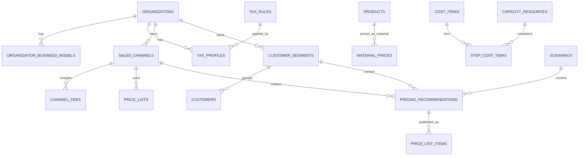

# SMART PRICING ENGINE
## Database Schema Specification v1.0

**Status:** Draft untuk review
**Database:** PostgreSQL 16+
**Menggantikan:** PRD v1.0 Bagian 7 untuk tabel yang disebut di sini. Tabel PRD yang tidak disebut di dokumen ini tetap berlaku apa adanya.
**Dokumen terkait:** `PRD.md` (v1.1), `CALCULATION_SPEC.md`

---

## 1. Konvensi

### 1.1 Tipe Data
| Kegunaan | Tipe |
|---|---|
| Primary key | `UUID` (v7 disarankan agar terurut waktu) |
| Nominal uang | `NUMERIC(20,4)` |
| Rate, persen, kurs | `NUMERIC(12,6)` (persen disimpan sebagai pecahan: 0.30) |
| Kurs mata uang | `NUMERIC(20,8)` |
| Kuantitas | `NUMERIC(20,6)` |
| Faktor konversi satuan | `NUMERIC(24,10)` |
| Timestamp | `TIMESTAMPTZ`, disimpan UTC |
| Tanggal berlaku | `DATE` |
| Enum | `TEXT` + `CHECK` constraint (lebih mudah dimigrasi daripada `ENUM` PostgreSQL) |

**Dilarang:** `REAL`, `DOUBLE PRECISION`, `MONEY` untuk nilai finansial.

### 1.2 Kolom Standar
Setiap tabel milik tenant memiliki:
```
organization_id  UUID NOT NULL
created_at       TIMESTAMPTZ NOT NULL DEFAULT now()
created_by       UUID NULL
updated_at       TIMESTAMPTZ NOT NULL DEFAULT now()
row_version      INTEGER NOT NULL DEFAULT 1     -- optimistic concurrency
```

### 1.3 Tabel Berversi (Effective-Dated)
Tabel yang nilainya berubah dari waktu ke waktu memakai pola:
```
effective_from  DATE NOT NULL
effective_to    DATE NULL          -- NULL = masih berlaku; eksklusif
data_nature     TEXT NOT NULL      -- ACTUAL | STANDARD | ESTIMATE | SCENARIO
```
dengan exclusion constraint agar periode untuk kunci yang sama tidak tumpang tindih:
```sql
EXCLUDE USING gist (
  organization_id WITH =, <kunci_bisnis> WITH =, data_nature WITH =,
  daterange(effective_from, effective_to, '[)') WITH &&
)
```
Baris lama **tidak pernah di-UPDATE nilainya**; perubahan = tutup `effective_to` baris lama + INSERT baris baru.

### 1.4 Isolasi Tenant (Wajib)
Tenant isolation bukan sekadar filter `organization_id` di API. Tiga lapis:

1. **Composite foreign key.** Setiap tabel tenant memiliki `UNIQUE (organization_id, id)`, dan setiap FK ke tabel tenant lain memakai pasangan `(organization_id, <fk>_id)`. Dengan begitu, baris milik organisasi A tidak mungkin merujuk baris milik organisasi B.
   ```sql
   FOREIGN KEY (organization_id, product_id) REFERENCES products (organization_id, id)
   ```
2. **Row-Level Security.** Seluruh tabel tenant `ENABLE ROW LEVEL SECURITY` + `FORCE ROW LEVEL SECURITY`, dengan policy:
   ```sql
   USING (organization_id = current_setting('app.current_org_id')::uuid)
   WITH CHECK (organization_id = current_setting('app.current_org_id')::uuid)
   ```
   Backend mengatur `SET LOCAL app.current_org_id` di awal setiap transaksi setelah otorisasi. Role database aplikasi **bukan** owner tabel dan tidak memiliki `BYPASSRLS`.
3. **Otorisasi API.** `organization_id` dari klien tidak pernah dipercaya; selalu diturunkan dari keanggotaan pengguna yang terautentikasi.

Tabel anak (mis. `bom_items`) juga menyimpan `organization_id` secara langsung, sehingga policy RLS tidak bergantung pada join.

---

## 2. Perubahan terhadap PRD v1.0

| Tabel | Perubahan |
|---|---|
| `organizations` | `business_type` diganti tabel `organization_business_models` (multi-pilihan untuk Hybrid). |
| `products` | **Tidak** menyimpan `current_cost` / `current_selling_price`. Nilai terkini diturunkan dari versi aktif (view `v_product_current`). Tambah `pricing_model_type` (`STANDARD`, `PROJECT_BASED`). |
| `bill_of_materials` | `yield_percentage` diganti `process_yield_rate`. Tambah `planned_output_qty`. |
| `bom_items` | `waste_percentage` diganti `material_waste_rate` (definisi: persentase dari material input). Tambah `organization_id`. |
| `costing_versions` | Tambah `data_nature`, `engine_version`, `input_snapshot`, `input_hash`, `scrap_rate`, `rework_rate`, `rework_cost_per_unit`. |
| `cost_items` | `cost_scope` wajib: `PRODUCT` / `PERIOD` / `ALLOCATION_POOL`. Tambah `percentage_base` untuk tipe `PERCENTAGE`. |
| `cost_rates` | Tambah `data_nature`; berpola effective-dated (§1.3). |
| `price_list_items` | Tambah `effective_from`, `effective_to`, `version_number`, `status`, `source_recommendation_id`. |
| `pricing_recommendations` | Tambah konteks lengkap (lihat §3.6). |
| `approvals` | Tambah constraint four-eyes (§3.8). |
| `roles` | Tambah `is_system` untuk role bawaan. |
| `users` | Tambah `is_platform_admin`. |

---

## 3. Tabel Baru dan Tabel yang Direvisi

### 3.1 Struktur Bisnis

**organization_business_models**
| Kolom | Tipe | Catatan |
|---|---|---|
| id | UUID PK | |
| organization_id | UUID FK | |
| business_model | TEXT | `MANUFACTURING`, `TRADING`, `DISTRIBUTION`, `RETAIL`, `SERVICES` |
| is_primary | BOOLEAN | tepat satu `true` per organisasi |

Organisasi dengan lebih dari satu baris = **Hybrid**. `PROJECT_BASED` bukan business model, melainkan `pricing_model_type` pada produk/jasa.

### 3.2 Penjualan

**sales_channels**
| Kolom | Tipe | Catatan |
|---|---|---|
| id | UUID PK | |
| organization_id | UUID FK | |
| code, name | TEXT | mis. `MARKETPLACE_A`, `RETAIL`, `DISTRIBUTOR`, `DIRECT` |
| channel_type | TEXT | `MARKETPLACE`, `RETAIL`, `WHOLESALE`, `DISTRIBUTOR`, `DIRECT`, `PROJECT` |
| status | TEXT | |

**channel_fees** (effective-dated)
| Kolom | Tipe | Catatan |
|---|---|---|
| id | UUID PK | |
| organization_id | UUID FK | |
| sales_channel_id | UUID FK | |
| name | TEXT | mis. "Komisi marketplace", "Payment fee" |
| fee_type | TEXT | `PERCENTAGE`, `FIXED_PER_UNIT`, `FIXED_PER_ORDER` |
| percentage_base | TEXT NULL | `LIST_PRICE`, `NET_PRICE`, `GROSS_PRICE` (wajib jika `PERCENTAGE`) |
| rate | NUMERIC(12,6) NULL | |
| amount | NUMERIC(20,4) NULL | |
| effective_from, effective_to, data_nature | | §1.3 |

**customer_segments**
| Kolom | Tipe |
|---|---|
| id, organization_id, code, name, description, status | |

**customers** (hanya jika analisis pelanggan diaktifkan)
| Kolom | Tipe | Catatan |
|---|---|---|
| id | UUID PK | |
| organization_id | UUID FK | |
| customer_segment_id | UUID FK NULL | |
| code, name | TEXT | |
| contact_email, contact_phone | TEXT NULL | **Data pribadi** (UU PDP) — lihat §5 |
| status | TEXT | |

### 3.3 Mata Uang

**exchange_rates**
| Kolom | Tipe | Catatan |
|---|---|---|
| id | UUID PK | |
| organization_id | UUID FK | kurs bisa berbeda per organisasi |
| from_currency, to_currency | CHAR(3) | ISO 4217 |
| rate_type | TEXT | `SPOT`, `BUDGET`, `TAX` (kurs pajak/KMK), `CUSTOM` |
| rate | NUMERIC(20,8) | |
| rate_date | DATE | |
| source | TEXT | asal kurs |

UNIQUE `(organization_id, from_currency, to_currency, rate_type, rate_date)`.

### 3.4 Material dan Costing

**material_prices** (effective-dated)
| Kolom | Tipe | Catatan |
|---|---|---|
| id | UUID PK | |
| organization_id | UUID FK | |
| material_product_id | UUID FK → products | |
| supplier_name | TEXT NULL | |
| unit_id | UUID FK | |
| currency | CHAR(3) | |
| unit_price | NUMERIC(20,4) | |
| effective_from, effective_to, data_nature | | §1.3 |
| source_reference | TEXT NULL | no. invoice / penawaran / asumsi |

**bill_of_materials** (revisi)
| Kolom | Tipe | Catatan |
|---|---|---|
| id, organization_id, product_id, version_number, status | | |
| planned_output_qty | NUMERIC(20,6) | `Q_plan` |
| output_unit_id | UUID FK | |
| process_yield_rate | NUMERIC(12,6) | `0 < y ≤ 1`, default 1 |
| effective_from, effective_to | DATE | |

**bom_items** (revisi)
| Kolom | Tipe | Catatan |
|---|---|---|
| id, organization_id, bom_id | | |
| material_product_id | UUID FK | |
| net_quantity | NUMERIC(20,6) | kebutuhan bersih untuk `planned_output_qty` |
| unit_id | UUID FK | |
| material_waste_rate | NUMERIC(12,6) | `0 ≤ w < 1`, persentase dari input |

**costing_versions** (revisi)
| Kolom | Tipe | Catatan |
|---|---|---|
| id, organization_id, product_id, version_number | | |
| costing_method | TEXT | `STANDARD`, `ACTUAL`, `ESTIMATED` |
| costing_structure | TEXT | `BOM_BASED`, `PROCESS_BASED`, `LANDED_COST`, `SERVICE`, `DIRECT_INPUT` |
| data_nature | TEXT | |
| bom_id | UUID FK NULL | |
| scrap_rate, rework_rate | NUMERIC(12,6) | |
| rework_cost_per_unit | NUMERIC(20,4) | |
| calculated_unit_cost | NUMERIC(20,4) | |
| currency | CHAR(3) | |
| effective_from, effective_to | DATE | |
| status | TEXT | `DRAFT`, `ACTIVE`, `SUPERSEDED` |
| engine_version | TEXT | |
| input_snapshot, calculation_snapshot | JSONB | immutable setelah `ACTIVE` |
| input_hash | CHAR(64) | |

Trigger: baris dengan status `ACTIVE` atau `SUPERSEDED` tidak boleh diubah kecuali kolom `status` dan `effective_to`.

### 3.5 Biaya Bertingkat dan Kapasitas

**capacity_resources**
| Kolom | Tipe | Catatan |
|---|---|---|
| id, organization_id, name | | |
| resource_type | TEXT | `LABOR`, `MACHINE`, `WAREHOUSE`, `LOGISTICS`, `SHIFT` |
| driver_id | UUID FK → cost_drivers | aktivitas yang menentukan kebutuhan |
| regular_capacity | NUMERIC(20,6) | per periode |
| max_overtime_capacity | NUMERIC(20,6) NULL | |
| overtime_multiplier | NUMERIC(12,6) NULL | mis. 1.5 |
| max_capacity | NUMERIC(20,6) NULL | batas keras; di atas ini → `CAPACITY_EXCEEDED` |

**step_cost_tiers** (effective-dated)
| Kolom | Tipe | Catatan |
|---|---|---|
| id, organization_id | | |
| cost_item_id | UUID FK | cost item bertipe `STEP_FIXED` |
| capacity_resource_id | UUID FK NULL | |
| tier_mode | TEXT | `TABLE` atau `CEILING` |
| from_activity, to_activity | NUMERIC(20,6) | untuk `TABLE` |
| resource_count | NUMERIC(20,6) NULL | mis. 8 operator |
| tier_amount | NUMERIC(20,4) | biaya tier (TABLE) atau biaya per sumber daya (CEILING) |
| capacity_per_resource | NUMERIC(20,6) NULL | untuk `CEILING` |
| effective_from, effective_to, data_nature | | |

Constraint: rentang `from_activity–to_activity` tidak boleh tumpang tindih untuk cost item dan periode yang sama.

### 3.6 Pricing

**price_lists** — sesuai PRD, ditambah `sales_channel_id UUID FK NULL`.

**price_list_items** (revisi, effective-dated)
| Kolom | Tipe | Catatan |
|---|---|---|
| id, organization_id, price_list_id, product_id | | |
| version_number | INTEGER | |
| list_price | NUMERIC(20,4) | |
| price_includes_vat | BOOLEAN | |
| tax_rule_id | UUID FK NULL | |
| discount_policy | JSONB | |
| effective_from, effective_to | DATE | |
| status | TEXT | `DRAFT`, `PENDING_APPROVAL`, `PUBLISHED`, `SUPERSEDED` |
| source_recommendation_id | UUID FK NULL | |
| override_reason | TEXT NULL | wajib jika harga < minimum price |
| override_by | UUID FK NULL | |

**pricing_recommendations** (revisi)
| Kolom | Tipe | Catatan |
|---|---|---|
| id, organization_id, product_id | | |
| costing_version_id | UUID FK | |
| sales_channel_id | UUID FK NULL | |
| customer_segment_id | UUID FK NULL | |
| pricing_model_id | UUID FK NULL | |
| scenario_id | UUID FK NULL | |
| pricing_method | TEXT | |
| margin_definition | TEXT | `GROSS`, `CONTRIBUTION`, `OPERATING` |
| minimum_price, target_price, recommended_price, list_price | NUMERIC(20,4) | |
| expected_gross_margin, expected_contribution_margin | NUMERIC(12,6) | |
| currency | CHAR(3) | |
| effective_date | DATE | |
| warnings | JSONB | |
| engine_version | TEXT | |
| input_snapshot, calculation_snapshot | JSONB | |
| input_hash | CHAR(64) | |
| status | TEXT | `DRAFT`, `PENDING_APPROVAL`, `APPROVED`, `REJECTED`, `PUBLISHED` |

### 3.7 Pajak

**tax_profiles** (effective-dated)
| Kolom | Tipe | Catatan |
|---|---|---|
| id, organization_id | | |
| taxpayer_type | TEXT | `INDIVIDUAL`, `SOLE_PROPRIETOR_COMPANY` (perseroan perorangan), `COOPERATIVE`, `PT`, `CV`, `OTHER` |
| is_vat_registered | BOOLEAN | status PKP |
| income_tax_regime | TEXT | `PROFIT_BASED`, `TURNOVER_FINAL` |
| income_tax_rule_id | UUID FK → tax_rules | |
| eligibility_note | TEXT | dasar kelayakan, diisi pengguna/konsultan |
| effective_from, effective_to | DATE | |

**tax_rules** (effective-dated; dikelola per organisasi, dengan template bawaan dari platform)
| Kolom | Tipe | Catatan |
|---|---|---|
| id | UUID PK | |
| organization_id | UUID FK NULL | NULL = template platform (read-only bagi tenant) |
| jurisdiction | TEXT | mis. `ID` |
| tax_type | TEXT | `VAT`, `INCOME_TAX`, `WITHHOLDING`, `LUXURY_SALES_TAX`, `REGIONAL`, `OTHER` |
| tax_category | TEXT | `TAX_EXPENSE`, `TAX_CREDIT`, `WITHHELD_BY_OTHERS`, `PASS_THROUGH` |
| calculation_basis | TEXT | `NET_PRICE`, `PROFIT_BEFORE_TAX`, `GROSS_TURNOVER`, `PURCHASE_VALUE`, ... |
| nominal_rate | NUMERIC(12,6) | |
| dpp_method | TEXT NULL | `FULL`, `OTHER_VALUE`, `SPECIFIC_AMOUNT` |
| dpp_factor | NUMERIC(24,10) NULL | mis. 11/12 |
| exempt_threshold_amount | NUMERIC(20,4) NULL | mis. bagian omzet yang tidak dikenai pajak |
| max_turnover_threshold | NUMERIC(20,4) NULL | ambang maksimum rezim |
| applies_to | JSONB | jenis transaksi, klasifikasi barang/jasa, jenis wajib pajak |
| legal_reference | TEXT | dasar hukum (mis. nomor PP/PMK) |
| effective_from, effective_to | DATE | |
| verified_by, verified_at | | siapa yang memverifikasi aturan |

### 3.8 Approval (revisi)
Tambah constraint four-eyes:
```sql
CHECK (approved_by IS NULL OR approved_by <> requested_by)
```
Ditambah validasi di service layer: approver harus memiliki permission `pricing.approve` (atau permission sesuai `entity_type`) di organisasi yang sama.

### 3.9 Simulasi
`scenarios`, `simulation_runs`, `simulation_results` sesuai PRD, dengan tambahan pada `simulation_runs`: `input_hash CHAR(64)`, `as_of_date DATE`, `warnings JSONB`. `simulation_runs` dan `simulation_results` bersifat **append-only** (tidak ada UPDATE/DELETE kecuali oleh proses retensi platform).

---

## 4. View Turunan

**v_product_current** — biaya dan harga terkini per produk:
- `current_unit_cost` dari `costing_versions` dengan `status = 'ACTIVE'` dan berlaku pada `CURRENT_DATE`.
- `current_list_price` per price list dari `price_list_items` dengan `status = 'PUBLISHED'` yang berlaku pada `CURRENT_DATE`.

Tidak ada kolom "current" yang disimpan di tabel `products`.

---

## 5. Data Pribadi (UU PDP No. 27/2022)

- Kolom berisi data pribadi ditandai di katalog skema (`COMMENT ON COLUMN ... IS 'PII'`): `users.email`, `users.full_name`, `customers.contact_email`, `customers.contact_phone`, dll.
- Data pribadi **tidak** dikirim ke penyedia LLM. AI Advisor hanya menerima agregat finansial dan ID produk/kategori; nama pelanggan diganti pseudonim.
- `audit_logs` mencatat akses ke data pelanggan.
- Kebijakan retensi dan penghapusan atas permintaan subjek data diterapkan pada tabel `customers` dan `users`.

---

## 6. Index Minimum
- Seluruh FK.
- `(organization_id, status)` pada tabel master.
- `(organization_id, <kunci>, effective_from DESC)` pada setiap tabel effective-dated.
- `(organization_id, created_at DESC)` pada `audit_logs`, `simulation_runs`, `pricing_recommendations`.
- `(organization_id, entity_type, status)` pada `approvals`.

---

## 7. Relasi Utama (Tambahan dari PRD §7.2)


