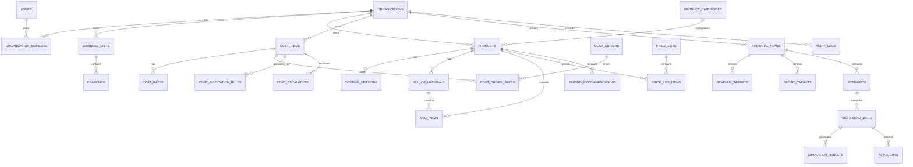

# SMART PRICING ENGINE
## Product Requirements Document (PRD)
**Version:** 1.1  
**Status:** Product Definition & Development Specification  
**Product Type:** Universal Web-Based Financial Planning & Pricing Intelligence Platform  
**Languages:** Bahasa Indonesia / English  
**Architecture:** Multi-Tenant SaaS-Ready Modular Application  
**Primary Users:** Business Owners, Directors, Finance Managers, Financial Analysts

---

# 0. CHANGELOG v1.1

## 0.1 Hierarki Dokumen

| Dokumen | Isi | Status terhadap PRD |
|---|---|---|
| `PRD.md` (dokumen ini) | Visi, modul, UI, roadmap | Induk |
| `CALCULATION_SPEC.md` v1.0 | Seluruh rumus, basis, status, batasan | **Mengikat** — menggantikan Bagian 8.3 dan 8.4 |
| `DATABASE_SPEC.md` v1.0 | Skema yang direvisi, isolasi tenant, presisi | **Mengikat** — menggantikan Bagian 7 untuk tabel yang disebut |
| `TEST_SUITE_SPEC.md` v1.0 | Test case dengan input & expected output | **Mengikat** — memperluas Bagian 8.5 |

Jika PRD dan dokumen teknis berbeda, dokumen teknis yang berlaku. Rumus baru tidak boleh diimplementasikan sebelum ditambahkan ke `CALCULATION_SPEC.md`.

## 0.2 Ringkasan Perubahan

**Rumus**
1. Biaya persentase (fee marketplace, komisi, payment fee) dihitung secara aljabar dalam pricing; basisnya wajib eksplisit (`LIST_PRICE`, `NET_PRICE`, `GROSS_PRICE`, dll.). Rumus `Unit Cost / (1 − GM)` tetap benar hanya untuk **gross margin**; untuk margin setelah fee dipakai **contribution margin**: `N = (C + V) / (1 − M − P)`.
2. Diskon dihitung mundur bila target margin harus tercapai setelah diskon: `L = N / (1 − D)`.
3. Kehilangan produksi dipisah menjadi `material_waste_rate`, `process_yield_rate`, `scrap_rate`, dan `rework_rate` dengan definisi eksplisit.
4. BEP mengembalikan kode status (`NO_BREAK_EVEN`, `NO_BREAK_EVEN_WITHIN_CAPACITY`, `INVALID_INPUT`, `UNBOUNDED`), tidak pernah angka negatif. Dengan step-fixed cost, BEP dihitung per tier dan dilaporkan sebagai rentang menguntungkan.
5. Pembulatan hanya pada output; ada **margin guard** yang menaikkan harga satu increment bila pembulatan membuat margin di bawah target.

**Pajak**
6. Seluruh aturan pajak berbasis konfigurasi (`tax_rules`, `tax_profiles`), tidak ditanam di engine. PPN mendukung tarif nominal + metode DPP (termasuk nilai lain 11/12).
7. PPh Final berbasis omzet **tidak** diasumsikan berlaku untuk semua pengguna; kelayakan bergantung pada profil wajib pajak dan regulasi yang berlaku (tim review merujuk PP 20/2026 — wajib diverifikasi konsultan pajak). Dapat dimuat ke harga sebagai alokasi beban pajak untuk perencanaan, dengan label eksplisit.
8. PPh 22/23 yang dipotong pihak lain adalah kredit pajak, bukan biaya. Kategori beban pajak, pajak terutang, kredit pajak, pajak dipotong pihak lain, dan arus kas pajak dipisahkan.

**Database**
9. Tabel baru: `organization_business_models`, `sales_channels`, `channel_fees`, `customer_segments`, `customers`, `exchange_rates`, `material_prices`, `capacity_resources`, `step_cost_tiers`, `tax_profiles`, `tax_rules`.
10. `price_list_items` berversi (effective-dated); `pricing_recommendations` menyimpan konteks lengkap (channel, segmen, skenario, costing version, engine version, snapshot).
11. `products` tidak menyimpan current cost/price; nilai terkini diturunkan dari versi aktif.
12. Pemisahan data `ACTUAL`, `STANDARD`, `ESTIMATE`, `SCENARIO`.
13. Isolasi tenant tiga lapis: composite foreign key, PostgreSQL RLS (forced), dan otorisasi API.
14. Presisi: `NUMERIC(20,4)` nominal, `NUMERIC(12,6)` rate, `NUMERIC(20,6)` kuantitas, `NUMERIC(24,10)` faktor konversi.

**Produk & Tata Kelola**
15. Business model: Manufacturing, Trading, Distribution, Retail, Services; **Hybrid** = lebih dari satu model. **Project-based** diperlakukan sebagai pricing/operating model, bukan business model.
16. Approval menerapkan prinsip four-eyes: pembuat permintaan tidak boleh menyetujui permintaannya sendiri.
17. Simulator memakai debounce ±300 ms untuk pratinjau; hasil final selalu dihitung dan divalidasi server.
18. Kepatuhan UU PDP No. 27/2022: penandaan kolom data pribadi, data pribadi tidak dikirim ke penyedia LLM, transparansi pemrosesan oleh AI Advisor.

## 0.3 Lingkup MVP yang Direvisi

Yang dibatasi adalah **fitur yang diluncurkan**, bukan kemampuan dasar engine. Engine tetap generik.

- **MVP:** Manufacturing dan Trading/Distribution.
- **Menyusul:** Retail dan Services (memakai fondasi engine yang sama).

## 0.4 Urutan Implementasi yang Direvisi

Bagian 11 tetap menjadi acuan deliverable, dengan urutan pengerjaan:

1. **Calculation Engine** — library Python murni tanpa UI/database, beserta seluruh test di `TEST_SUITE_SPEC.md`.
2. **Database & Backend** — PostgreSQL, FastAPI, autentikasi, organisasi, produk, biaya, histori.
3. **Product Costing** — BOM, harga material, labor, overhead, landed cost.
4. **Pricing** — metode pricing, biaya persentase, diskon, pajak, rekomendasi, approval.
5. **Planning & Simulation** — target, BEP, step-fixed, perbandingan skenario.
6. **Frontend & Dashboard** — dashboard direktur & finance, laporan.
7. **AI Advisor** — berbasis hasil kalkulasi tervalidasi.

---

# 1. PRODUCT VISION

## 1.1 Product Overview

Smart Pricing Engine adalah aplikasi berbasis web untuk membantu perusahaan merumuskan harga jual yang optimal berdasarkan struktur biaya, kapasitas operasional, target omzet, target profit, kondisi pasar, serta proyeksi perubahan biaya.

Aplikasi tidak hanya menghitung harga berdasarkan cost plus markup, tetapi menyediakan kemampuan financial simulation, dynamic cost projection, profitability analysis, dan intelligent pricing recommendation.

Sistem harus mampu menjawab pertanyaan:

- Berapa harga jual yang ideal untuk setiap produk?
- Berapa omzet yang harus dicapai untuk mendapatkan target profit?
- Bagaimana perubahan biaya memengaruhi harga jual?
- Bagaimana jika volume penjualan meningkat atau menurun?
- Bagaimana jika perusahaan menambah karyawan, mesin, gudang, atau kapasitas produksi?
- Produk mana yang paling menguntungkan?
- Bagaimana kombinasi produk yang menghasilkan profit optimal?
- Strategi harga seperti apa yang paling rasional untuk mencapai target perusahaan?

## 1.2 Product Objectives

1. Menyediakan perhitungan harga jual yang akurat dan transparan.
2. Mengintegrasikan seluruh struktur biaya dalam satu model.
3. Menghitung hubungan antara biaya, omzet, volume, dan profit.
4. Mengakomodasi berbagai model bisnis.
5. Menyediakan simulasi finansial yang dinamis.
6. Menghasilkan rekomendasi harga berdasarkan target bisnis.
7. Membantu manajemen mengambil keputusan berbasis data.
8. Menyediakan platform yang dapat dikembangkan menjadi SaaS.

## 1.3 Business Models Supported

| Business Model | Cost Calculation Basis |
|---|---|
| Manufacturing | BOM, material, labor, machine, overhead |
| Trading | Purchase cost, handling, storage, operating cost |
| Distribution | Landed cost, freight, logistics, commission |
| Retail | Purchase cost, selling expense, store overhead |
| Services | Labor hours, service resources, overhead |
| Project-based | Project cost, labor, material, duration |

Seluruh model bisnis harus menggunakan calculation engine yang sama, tetapi dengan konfigurasi dan komponen biaya yang berbeda.

## 1.4 Product Positioning

Smart Pricing Engine bukan:
- Accounting software.
- ERP pengganti.
- Inventory management system.
- General ledger.
- Tax filing application.

Smart Pricing Engine adalah:

**Financial Planning, Pricing & Profit Optimization System.**

Integrasi accounting dan ERP dapat dikembangkan kemudian melalui API atau data import.

---

# 2. USER PERSONAS & ACCESS CONTROL

## 2.1 Primary Personas

### Persona A — Business Owner / Director

Kebutuhan:
- Mengetahui kondisi profitabilitas perusahaan.
- Melihat apakah target perusahaan realistis.
- Menentukan target harga dan profit.
- Membandingkan skenario bisnis.
- Mendapatkan rekomendasi strategis.

Dashboard yang dibutuhkan:
- Revenue overview.
- Profit overview.
- Target achievement.
- Cost trend.
- Business scenarios.
- AI business insights.

### Persona B — Finance Manager / Financial Analyst

Kebutuhan:
- Memasukkan struktur biaya.
- Mengelola cost driver.
- Mengatur metode alokasi biaya.
- Menghitung product costing.
- Melakukan pricing simulation.
- Menganalisis margin dan break-even.
- Menyiapkan laporan untuk manajemen.

Dashboard yang dibutuhkan:
- Cost structure.
- Product costing.
- Pricing calculations.
- Simulation results.
- Profitability reports.
- Financial assumptions.

## 2.2 Roles & Permissions

| Role | Permission |
|---|---|
| Organization Owner | Full access |
| Director | Dashboard, planning, approval, reports |
| Finance Manager | Cost, pricing, planning, simulation |
| Financial Analyst | Data entry, calculations, reports |
| Operations Manager | Capacity, production cost, operational data |
| Sales Manager | Price lists, discount, sales assumptions |
| Viewer | Read-only access |
| Platform Administrator | SaaS platform administration |

Role dan permission harus dapat dikonfigurasi, bukan hanya hardcoded.

Setiap permission menggunakan prinsip RBAC (Role-Based Access Control).

---

# 3. FUNCTIONAL REQUIREMENTS

## MODULE 01 — Organization & Business Configuration

**Module ID:** MOD-001

Tujuan: Mengatur identitas, konfigurasi, dan karakteristik bisnis perusahaan.

### Features

- Organization profile.
- Multiple organizations.
- Business model selection.
- Multiple business units.
- Multiple branches.
- Currency configuration.
- Financial period configuration.
- Fiscal year configuration.
- Language selection.
- Tax configuration.
- Default costing method.
- Default pricing method.
- Capacity configuration.

### Business Configuration

Pengguna dapat memilih:
- Manufacturing.
- Trading.
- Distribution.
- Retail.
- Services.
- Hybrid.

Hybrid memungkinkan satu perusahaan memiliki lebih dari satu karakteristik bisnis.

*(v1.1)* Project-based bukan pilihan business model; ia diatur sebagai pricing/operating model per produk atau jasa (`pricing_model_type = PROJECT_BASED`).

### Acceptance Criteria

- Pengguna dapat membuat dan mengelola organisasi.
- Setiap organisasi memiliki konfigurasi terpisah.
- Semua data terhubung dengan organization ID.
- Pengguna dapat mengganti bahasa tanpa kehilangan data.
- Perubahan konfigurasi tidak mengubah hasil simulasi historis yang sudah disimpan.

---

## MODULE 02 — Product & Service Management

**Module ID:** MOD-002

### Features

1. Product master.
2. Service master.
3. Product category.
4. SKU / Product Code.
5. Unit of measurement.
6. Unit conversion.
7. BOM management.
8. Production routing.
9. Product specifications.
10. Product lifecycle status.
11. Product cost history.
12. Product price history.

### Product Attributes

- Product ID.
- Product name.
- SKU.
- Category.
- Business model.
- Unit of measure.
- Description.
- Production capacity.
- Current cost.
- Current selling price.
- Target margin.
- Target profit contribution.
- Active status.

### Manufacturing-specific features

- Bill of Materials.
- Raw material requirements.
- Production loss.
- Yield percentage.
- Labor requirements.
- Machine hours.
- Production overhead.

### Trading-specific features

- Purchase price.
- Supplier.
- Freight.
- Handling.
- Storage.
- Other acquisition expenses.

### Acceptance Criteria

- Produk dapat menggunakan BOM atau direct cost.
- Setiap produk dapat memiliki lebih dari satu costing version.
- Produk dapat menggunakan berbagai satuan.
- Perubahan biaya tidak menghapus histori biaya sebelumnya.

---

## MODULE 03 — Cost Management

**Module ID:** MOD-003

Tujuan: Menyediakan sistem pengelolaan biaya yang fleksibel dan dinamis.

### Cost Categories

1. Direct Material.
2. Direct Labor.
3. Production Overhead.
4. Fixed Operating Cost.
5. Variable Operating Cost.
6. Semi-Variable Cost.
7. Step-Fixed Cost.
8. Selling & Marketing Cost.
9. Distribution Cost.
10. Administrative Cost.
11. Financial Cost.
12. Tax & Statutory Charges.
13. Other Cost.

### Cost Behavior Types

| Type | Calculation Logic |
|---|---|
| Fixed | Constant within defined capacity range |
| Variable | Rate × activity |
| Semi-variable | Base cost + variable component |
| Step-fixed | Cost changes at defined thresholds |
| Percentage-based | Percentage × selected financial base |
| Tiered | Rate based on activity bracket |
| Time-based | Rate × time units |

### Cost Drivers

Sistem harus mendukung berbagai cost driver:

- Revenue.
- Sales units.
- Production units.
- Machine hours.
- Labor hours.
- Shipment count.
- Distance.
- Weight.
- Storage volume.
- Number of employees.
- Number of transactions.
- Custom driver.

### Cost Allocation Methods

- Direct assignment.
- Equal allocation.
- Revenue-based allocation.
- Unit-based allocation.
- Labor-hour allocation.
- Machine-hour allocation.
- Activity-based allocation.
- Custom allocation.

### Cost Escalation

Setiap komponen biaya dapat memiliki:

- Base cost.
- Effective date.
- Escalation type.
- Escalation rate.
- Escalation frequency.
- Escalation cap.
- Escalation floor.
- Source or assumption.
- Scenario override.

### Acceptance Criteria

- Satu komponen biaya dapat menggunakan lebih dari satu cost driver.
- Biaya dapat dikaitkan dengan produk, divisi, cabang, atau organisasi.
- Biaya dapat memiliki periode efektif.
- Sistem dapat menghitung kenaikan biaya berdasarkan skenario.
- Sistem tidak boleh menghitung biaya yang sama dua kali.

---

## MODULE 04 — Product Costing Engine

**Module ID:** MOD-004

Tujuan: Menghitung biaya produk atau jasa berdasarkan struktur operasionalnya.

### Manufacturing Costing

Komponen:

- Material cost.
- Direct labor.
- Machine cost.
- Production overhead.
- Packaging.
- Production waste.
- Quality control cost.
- Other direct cost.

Formula dasar:

Unit Cost = Total Production Cost / Good Units Produced

Untuk material dengan yield tertentu:

Required Material Cost per Good Unit = Material Input Cost / Yield

Sistem harus mendukung:
- Standard costing.
- Actual costing.
- Estimated costing.
- BOM-based costing.
- Process-based costing.

### Trading & Distribution Costing

Landed Cost = Purchase Cost + Freight + Handling + Other Acquisition Costs

Kemudian sistem dapat memasukkan biaya gudang, distribusi, dan penjualan berdasarkan metode alokasi yang dipilih.

### Service Costing

Service Cost = Direct Labor + Direct Expenses + Allocated Overhead

Sistem harus mendukung hourly rate, project-based costing, dan service package costing.

### Important Rule

Product Cost dan Period Operating Expense harus dipisahkan.

Jangan otomatis memasukkan seluruh biaya kantor atau administrasi ke HPP. Pengguna harus menentukan apakah suatu biaya merupakan biaya produk, biaya operasional periode, atau biaya yang dialokasikan untuk tujuan analisis internal.

---

## MODULE 05 — Pricing Management

**Module ID:** MOD-005

Tujuan: Menghasilkan rekomendasi harga jual berdasarkan berbagai metode.

### Supported Pricing Methods

1. Cost Plus Pricing.
2. Target Gross Margin Pricing.
3. Target Contribution Margin Pricing.
4. Target Operating Profit Pricing.
5. Break-Even Pricing.
6. Value-Based Pricing.
7. Competitive Pricing.
8. Minimum Viable Price.
9. Volume-Based Pricing.
10. Customer Segment Pricing.

### Pricing Attributes

- Product.
- Costing version.
- Pricing method.
- Target markup.
- Target gross margin.
- Target contribution margin.
- Target operating profit.
- Sales channel.
- Customer segment.
- Tax treatment.
- Discount allowance.
- Effective date.
- Price rounding policy.

### Price Recommendation Output

Setiap hasil rekomendasi harus menampilkan:

- Current cost.
- Current selling price.
- Minimum price.
- Recommended price.
- Target price.
- Gross margin.
- Contribution margin.
- Required volume.
- Expected revenue.
- Expected profit.
- Tax impact.
- Assumptions.
- Calculation explanation.

### Price List Management

Satu produk dapat memiliki berbagai harga:
- Retail.
- Wholesale.
- Distributor.
- Reseller.
- Project.
- Special contract.

Setiap price list harus memiliki tanggal berlaku dan histori versi.

---

## MODULE 06 — Revenue & Profit Planning

**Module ID:** MOD-006

### Features

- Monthly revenue targets.
- Quarterly revenue targets.
- Annual revenue targets.
- Target sales units.
- Target gross profit.
- Target operating profit.
- Target net profit.
- Target margin.
- Product-level targets.
- Branch-level targets.
- Sales channel targets.

### Planning Capabilities

Pengguna dapat memulai perencanaan dari:
- Target revenue.
- Target profit.
- Target margin.
- Sales volume.
- Available capacity.

Sistem menghitung parameter lainnya berdasarkan model yang digunakan.

### Important Financial Definitions

Aplikasi harus membedakan:

- Gross Profit.
- Contribution Margin.
- Operating Profit.
- Profit Before Tax.
- Net Profit.

Jangan menggunakan istilah profit tanpa definisi yang jelas.

---

## MODULE 07 — Financial Simulation & Scenario Analysis

**Module ID:** MOD-007

### Features

- What-if simulation.
- Best-case scenario.
- Base-case scenario.
- Worst-case scenario.
- Custom scenario.
- Revenue growth simulation.
- Cost inflation simulation.
- Selling price simulation.
- Production volume simulation.
- Capacity expansion simulation.
- Discount simulation.
- Tax impact simulation.

### Scenario Variables

Contoh:
- Revenue growth: +10%.
- Raw material increase: +8%.
- Salary increase: +5%.
- Electricity increase: +12%.
- Distribution cost increase: +10%.
- Selling price increase: +4%.
- Sales volume change: -3%.

### Comparison Output

Setiap skenario dibandingkan berdasarkan:

- Revenue.
- Total cost.
- Gross profit.
- Contribution margin.
- Operating profit.
- Net profit.
- Break-even revenue.
- Required sales volume.
- Capacity utilization.

Skenario harus dapat disimpan, diduplikasi, dan dibandingkan.

---

## MODULE 08 — Dynamic Cost & Capacity Engine

**Module ID:** MOD-008

Tujuan: Memperhitungkan perubahan biaya akibat perubahan aktivitas dan kapasitas.

### Features

- Capacity thresholds.
- Step-fixed cost.
- Additional workforce requirements.
- Additional production shifts.
- Machine utilization.
- Warehouse utilization.
- Logistics capacity.
- Overtime cost.
- Capacity expansion cost.

### Example

Produksi 10.000 unit membutuhkan 5 operator.

Produksi 15.000 unit membutuhkan 8 operator.

Produksi 20.000 unit membutuhkan 11 operator.

Sistem harus dapat menghitung tambahan tenaga kerja berdasarkan aturan kapasitas, bukan hanya mengalikan biaya lama dengan persentase pertumbuhan.

### Acceptance Criteria

- Biaya bertambah ketika threshold tercapai.
- Kapasitas maksimum tidak boleh dilampaui tanpa warning.
- Sistem dapat menghitung biaya ekspansi kapasitas.
- Semua perubahan tercatat dalam hasil simulasi.

---

## MODULE 09 — Profitability & Analytics

**Module ID:** MOD-009

### Reports

1. Company Profitability.
2. Product Profitability.
3. Customer Profitability.
4. Branch Profitability.
5. Sales Channel Profitability.
6. Cost Breakdown.
7. Contribution Margin Analysis.
8. Break-Even Analysis.
9. Revenue Forecast.
10. Cost Forecast.
11. Budget vs Forecast.
12. Scenario Comparison.

### Dashboard KPIs

- Revenue.
- COGS.
- Gross Profit.
- Gross Margin.
- Variable Cost.
- Contribution Margin.
- Fixed Cost.
- Operating Profit.
- Operating Margin.
- Profit Before Tax.
- Net Profit.
- Break-Even Revenue.
- Target Achievement.

Semua KPI harus memiliki definisi dan basis perhitungan yang konsisten.

---

## MODULE 10 — AI Business Advisor

**Module ID:** MOD-010

### Capabilities

**Diagnostic**
- Identify low-margin products.
- Detect abnormal cost increases.
- Identify unprofitable pricing.
- Detect unrealistic targets.
- Identify capacity bottlenecks.

**Predictive**
- Revenue projection.
- Cost projection.
- Profit projection.
- Margin projection.
- Scenario forecasting.

**Prescriptive**
- Suggest price adjustments.
- Suggest cost optimization.
- Recommend product mix.
- Recommend operational improvements.
- Explain business risks.

### AI Rules

1. AI hanya boleh menggunakan data dan hasil kalkulasi yang tersedia.
2. AI tidak boleh mengarang angka.
3. AI tidak boleh mengubah harga resmi secara otomatis.
4. Setiap rekomendasi harus memiliki referensi data.
5. AI harus menjelaskan asumsi.
6. AI harus mengungkapkan jika data tidak mencukupi.
7. Setiap tindakan yang mengubah data harus memerlukan persetujuan pengguna.

---

# 4. NON-FUNCTIONAL REQUIREMENTS

## 4.1 Performance

Target awal:

| Operation | Target |
|---|---|
| Dashboard loading | < 3 seconds |
| Standard calculation | < 2 seconds |
| Scenario calculation | < 5 seconds |
| Product listing | < 2 seconds |
| API response | < 500 ms for ordinary requests |

Angka ini merupakan target engineering, bukan jaminan sebelum pengujian dengan data dan infrastruktur nyata.

## 4.2 Security

- Secure authentication.
- Role-based access control.
- Organization-level data isolation.
- API authorization.
- Input validation.
- Rate limiting.
- Encrypted data transmission.
- Secure password storage.
- Audit trail.
- Database backup.
- Session management.

## 4.3 Data Integrity

- Use decimal arithmetic for financial calculations.
- Use immutable calculation snapshots.
- Use versioned cost and price records.
- Store calculation engine version.
- Prevent duplicate cost allocation.
- Use transactional database operations.

## 4.4 Internationalization

Support:
- Bahasa Indonesia.
- English.
- Localized date.
- Currency formatting.
- Number formatting.
- Decimal separators.
- Thousands separators.
- Time zone configuration.

Bahasa UI harus terpisah dari bahasa penyimpanan data. Nama produk, kategori, dan deskripsi pengguna tidak boleh otomatis diterjemahkan.

## 4.5 Scalability

Architecture harus mendukung:
- Multiple organizations.
- Multiple branches.
- Multiple users.
- Multiple currencies.
- Large product catalogs.
- Large simulation datasets.
- Background processing.
- API integration.

---

# 5. USER STORIES

Format: As a [role], I want [action], so that [business value].

## 5.1 Business Owner

| ID | User Story | Priority |
|---|---|---|
| US-001 | Melihat seluruh kondisi finansial perusahaan | P0 |
| US-002 | Menentukan target profit | P0 |
| US-003 | Melihat omzet yang dibutuhkan | P0 |
| US-004 | Membandingkan skenario bisnis | P1 |
| US-005 | Melihat produk paling menguntungkan | P1 |
| US-006 | Menerima rekomendasi harga | P0 |
| US-007 | Menyetujui perubahan harga | P1 |
| US-008 | Melihat risiko kenaikan biaya | P1 |

## 5.2 Finance Manager

| ID | User Story | Priority |
|---|---|---|
| US-009 | Membuat struktur biaya perusahaan | P0 |
| US-010 | Mengatur perilaku biaya | P0 |
| US-011 | Membuat cost allocation rules | P0 |
| US-012 | Menghitung unit cost | P0 |
| US-013 | Mengatur target margin | P0 |
| US-014 | Membuat price recommendation | P0 |
| US-015 | Melakukan cost escalation simulation | P1 |
| US-016 | Membuat laporan profitabilitas | P1 |
| US-017 | Membandingkan actual assumptions dengan forecast | P1 |

## 5.3 Operations Manager

| ID | User Story | Priority |
|---|---|---|
| US-018 | Mengatur kapasitas produksi | P1 |
| US-019 | Mengatur kebutuhan tenaga kerja | P1 |
| US-020 | Mengatur machine utilization | P1 |
| US-021 | Melihat dampak kapasitas terhadap biaya | P1 |

## 5.4 Sales Manager

| ID | User Story | Priority |
|---|---|---|
| US-022 | Melihat harga berdasarkan segmen pelanggan | P1 |
| US-023 | Mengatur diskon | P1 |
| US-024 | Mengetahui dampak diskon terhadap profit | P1 |
| US-025 | Membandingkan harga antar-channel | P1 |

## 5.5 System Administrator

| ID | User Story | Priority |
|---|---|---|
| US-026 | Mengelola organisasi | P0 |
| US-027 | Mengelola user dan roles | P0 |
| US-028 | Melihat audit log | P0 |
| US-029 | Mengelola konfigurasi sistem | P0 |
| US-030 | Mengatur bahasa aplikasi | P0 |

## 5.6 Definition of Done

Setiap user story dianggap selesai jika:
- Functional requirements terpenuhi.
- Validasi input berjalan.
- Permission berjalan.
- Unit test berhasil.
- Integration test berhasil.
- Error handling tersedia.
- UI responsive.
- Tidak ada kebocoran data antarorganisasi.
- Dokumentasi diperbarui.

---

# 6. COMPLETE UI / UX SPECIFICATION

## 6.1 Global Layout

**Desktop-first responsive web application.**

Layout:

- Left sidebar navigation.
- Top navigation bar.
- Main content area.
- Breadcrumb navigation.
- Global search.
- Notification center.
- Organization selector.
- Language selector.
- User profile menu.

Sidebar dapat collapsed.

Mobile harus tetap dapat digunakan untuk dashboard, melihat rekomendasi, dan menjalankan simulasi sederhana.

## 6.2 Page Inventory

### PAGE 01 — Login & Authentication

Route: `/login`

Components:
- Logo.
- Email.
- Password.
- Remember me.
- Forgot password.
- Login.
- Language selector.

### PAGE 02 — Organization Onboarding

Route: `/onboarding`

Steps:
1. Create organization.
2. Select business model.
3. Configure currency.
4. Configure fiscal period.
5. Configure language.
6. Create initial user roles.
7. Complete onboarding.

### PAGE 03 — Executive Dashboard

Route: `/dashboard`

Components:
- Revenue KPI.
- Total Cost KPI.
- Gross Profit KPI.
- Operating Profit KPI.
- Net Profit KPI.
- Break-even KPI.
- Revenue vs Cost chart.
- Profit trend.
- Cost composition.
- Product profitability.
- Target achievement.
- AI alerts.

Filters:
- Period.
- Branch.
- Business unit.
- Product category.

### PAGE 04 — Organization Settings

Route: `/settings/organization`

Tabs:
- General.
- Business Model.
- Financial Settings.
- Currency.
- Tax.
- Fiscal Period.
- Language.
- Capacity.

### PAGE 05 — Product List

Route: `/products`

Components:
- Search.
- Category filter.
- Business model filter.
- Status filter.
- Product table.
- Add product.
- Import CSV/XLSX.
- Export.

### PAGE 06 — Product Detail

Route: `/products/:id`

Tabs:
- General Information.
- Costing.
- BOM.
- Production.
- Pricing.
- Profitability.
- History.

### PAGE 07 — Product Costing

Route: `/products/:id/costing`

Components:
- Costing method.
- Material cost.
- Labor cost.
- Machine cost.
- Overhead.
- Packaging.
- Waste/yield.
- Unit cost.
- Cost breakdown chart.
- Cost version history.

### PAGE 08 — BOM Management

Route: `/products/:id/bom`

Components:
- BOM header.
- Material selection.
- Quantity.
- Unit.
- Waste factor.
- Yield.
- Effective date.
- BOM version.
- Total material cost.

### PAGE 09 — Cost Overview

Route: `/costs`

Components:
- Total fixed cost.
- Total variable cost.
- Total semi-variable cost.
- Total step-fixed cost.
- Cost trend.
- Cost distribution.
- Cost list.
- Add cost.

### PAGE 10 — Cost Detail

Route: `/costs/:id`

Tabs:
- General.
- Behavior.
- Cost Drivers.
- Escalation.
- Allocation.
- History.

### PAGE 11 — Cost Allocation

Route: `/costs/allocation`

Components:
- Allocation pool.
- Allocation basis.
- Eligible products.
- Allocation percentages.
- Allocation validation.
- Preview results.

### PAGE 12 — Pricing Overview

Route: `/pricing`

Components:
- Product.
- Current price.
- Current unit cost.
- Gross margin.
- Contribution margin.
- Target margin.
- Pricing status.
- Generate recommendation.

### PAGE 13 — Pricing Calculator

Route: `/pricing/calculator`

Wizard:

1. Select product.
2. Select costing version.
3. Select pricing method.
4. Set target margin/profit.
5. Set tax treatment.
6. Set discount assumptions.
7. Calculate.
8. Review recommendation.

Output:
- Minimum price.
- Recommended price.
- Target price.
- Margin.
- Revenue.
- Profit.
- Explanation.

### PAGE 14 — Price Recommendation Detail

Route: `/pricing/recommendations/:id`

Components:
- Recommendation summary.
- Cost breakdown.
- Price comparison.
- Margin waterfall.
- Target achievement.
- Risk indicators.
- Assumption list.
- Approval.
- Publish price.

### PAGE 15 — Price Lists

Route: `/pricing/price-lists`

Components:
- Price list name.
- Customer segment.
- Sales channel.
- Currency.
- Effective date.
- Product prices.
- Discount conditions.
- Status.

### PAGE 16 — Revenue Planning

Route: `/planning/revenue`

Components:
- Period selection.
- Revenue target.
- Sales unit target.
- Product allocation.
- Branch allocation.
- Sales channel allocation.
- Monthly projection.

### PAGE 17 — Profit Planning

Route: `/planning/profit`

Components:
- Profit target.
- Profit definition.
- Cost assumptions.
- Contribution margin.
- Required revenue.
- Required units.
- Break-even analysis.
- Feasibility assessment.

### PAGE 18 — Scenario Manager

Route: `/scenarios`

Components:
- Scenario list.
- Base scenario.
- Optimistic scenario.
- Pessimistic scenario.
- Duplicate scenario.
- New scenario.
- Compare scenarios.

### PAGE 19 — Scenario Simulator

Route: `/scenarios/:id`

Components:
- Revenue adjustment.
- Price adjustment.
- Volume adjustment.
- Cost escalation.
- Capacity adjustment.
- Tax adjustment.
- Real-time recalculation.
- Result charts.
- Save simulation.

### PAGE 20 — Scenario Comparison

Route: `/scenarios/compare`

Components:
- Revenue comparison.
- Cost comparison.
- Profit comparison.
- Margin comparison.
- Break-even comparison.
- Capacity comparison.
- Recommendation.

### PAGE 21 — Capacity Planning

Route: `/operations/capacity`

Components:
- Production capacity.
- Machine capacity.
- Labor capacity.
- Warehouse capacity.
- Utilization.
- Capacity thresholds.
- Additional shift.
- Expansion simulation.

### PAGE 22 — Profitability Analysis

Route: `/analytics/profitability`

Tabs:
- Product.
- Customer.
- Branch.
- Channel.
- Business Unit.

### PAGE 23 — Cost Analytics

Route: `/analytics/cost`

Components:
- Cost trend.
- Cost composition.
- Cost per unit.
- Cost driver analysis.
- Cost escalation.
- Variance analysis.

### PAGE 24 — Reports Center

Route: `/reports`

Reports:
- Executive Summary.
- Product Costing.
- Pricing Analysis.
- Profitability.
- Break-even.
- Scenario Comparison.
- Financial Forecast.

Export:
- PDF.
- Excel.
- CSV.

### PAGE 25 — AI Business Advisor

Route: `/advisor`

Components:
- Conversational interface.
- Suggested questions.
- Financial context.
- Insight cards.
- Recommendation cards.
- Supporting calculations.
- Data references.
- Confidence and limitations.

### PAGE 26 — User Management

Route: `/settings/users`

Components:
- Users.
- Roles.
- Invitations.
- Permissions.
- Access status.

### PAGE 27 — Approval Center

Route: `/approvals`

Components:
- Pending price approvals.
- Pending scenario approvals.
- Change history.
- Approver.
- Approval status.
- Comments.

*(v1.1)* Prinsip four-eyes: pengguna yang membuat permintaan tidak dapat menyetujui permintaannya sendiri.

### PAGE 28 — Audit Trail

Route: `/settings/audit-logs`

Components:
- User.
- Action.
- Entity.
- Timestamp.
- Before/after values.
- Filters.

### PAGE 29 — Integration & Import

Route: `/settings/integrations`

MVP:
- CSV import.
- XLSX import.
- CSV export.
- XLSX export.

Future:
- Accounting integration.
- ERP integration.
- REST API access.
- External data sources.

---

# 7. DATABASE ARCHITECTURE & FINAL ERD

Database: PostgreSQL.

Architecture principles:
- Relational database.
- UUID primary keys.
- Multi-tenant organization isolation.
- NUMERIC for financial values.
- Effective-date versioning.
- Immutable simulation snapshots.
- Foreign key integrity.
- Database-level tenant security.

## 7.1 Core Database Tables

### Organization & Users

**organizations**
- id UUID PK
- name
- slug
- business_type
- default_currency
- default_language
- fiscal_year_start
- timezone
- status
- created_at
- updated_at

**organization_settings**
- id UUID PK
- organization_id FK
- setting_key
- setting_value JSONB

**users**
- id UUID PK
- email
- password_hash / external_auth_id
- full_name
- preferred_language
- status
- created_at

**organization_members**
- id UUID PK
- organization_id FK
- user_id FK
- status
- joined_at

**roles**
- id UUID PK
- organization_id FK nullable
- name
- description

**permissions**
- id UUID PK
- permission_key
- description

**role_permissions**
- role_id FK
- permission_id FK

**member_roles**
- organization_member_id FK
- role_id FK

### Business Structure

**business_units**
- id UUID PK
- organization_id FK
- name
- business_model
- status

**branches**
- id UUID PK
- organization_id FK
- business_unit_id FK
- name
- location
- status

### Product Management

**product_categories**
- id UUID PK
- organization_id FK
- name
- parent_id FK nullable

**units_of_measure**
- id UUID PK
- organization_id FK
- code
- name
- dimension

**unit_conversions**
- id UUID PK
- organization_id FK
- from_unit_id FK
- to_unit_id FK
- conversion_factor

**products**
- id UUID PK
- organization_id FK
- category_id FK
- sku
- name
- product_type
- business_model
- base_unit_id FK
- description
- status
- created_at
- updated_at

### Product Costing

**costing_versions**
- id UUID PK
- organization_id FK
- product_id FK
- version_number
- costing_method
- effective_from
- effective_to
- status
- calculated_unit_cost NUMERIC
- calculation_snapshot JSONB

**bill_of_materials**
- id UUID PK
- organization_id FK
- product_id FK
- version_id FK
- output_quantity NUMERIC
- output_unit_id FK
- yield_percentage NUMERIC
- status

**bom_items**
- id UUID PK
- bom_id FK
- material_product_id FK
- quantity NUMERIC
- unit_id FK
- waste_percentage NUMERIC

**production_resources**
- id UUID PK
- organization_id FK
- name
- resource_type
- hourly_rate NUMERIC
- capacity_per_hour NUMERIC

**production_routes**
- id UUID PK
- organization_id FK
- product_id FK
- resource_id FK
- operation_name
- hours_per_batch NUMERIC

### Cost Management

**cost_categories**
- id UUID PK
- organization_id FK
- name
- category_type

**cost_items**
- id UUID PK
- organization_id FK
- category_id FK
- name
- behavior_type
- cost_scope
- default_period
- currency
- status

**cost_rates**
- id UUID PK
- organization_id FK
- cost_item_id FK
- base_amount NUMERIC
- effective_from
- effective_to
- minimum_amount NUMERIC nullable
- maximum_amount NUMERIC nullable

**cost_drivers**
- id UUID PK
- organization_id FK
- name
- driver_type
- unit_id FK nullable

**cost_driver_rates**
- id UUID PK
- cost_item_id FK
- driver_id FK
- rate NUMERIC
- effective_from
- effective_to

**cost_allocation_rules**
- id UUID PK
- organization_id FK
- cost_item_id FK
- allocation_method
- driver_id FK nullable
- configuration JSONB

**cost_allocations**
- id UUID PK
- organization_id FK
- cost_item_id FK
- target_type
- target_id UUID
- allocation_percentage NUMERIC
- allocated_amount NUMERIC

**cost_escalations**
- id UUID PK
- organization_id FK
- cost_item_id FK
- escalation_type
- escalation_rate NUMERIC
- frequency
- effective_from
- configuration JSONB

### Pricing

**pricing_models**
- id UUID PK
- organization_id FK
- name
- method
- configuration JSONB

**price_lists**
- id UUID PK
- organization_id FK
- name
- customer_segment_id FK nullable
- currency
- effective_from
- effective_to
- status

**price_list_items**
- id UUID PK
- price_list_id FK
- product_id FK
- selling_price NUMERIC
- tax_treatment
- discount_policy JSONB

**pricing_recommendations**
- id UUID PK
- organization_id FK
- product_id FK
- costing_version_id FK
- pricing_method
- recommended_price NUMERIC
- minimum_price NUMERIC
- target_price NUMERIC
- expected_margin NUMERIC
- assumptions JSONB
- calculation_snapshot JSONB
- engine_version
- status
- created_at

### Planning & Simulation

**planning_periods**
- id UUID PK
- organization_id FK
- name
- start_date
- end_date
- status

**financial_plans**
- id UUID PK
- organization_id FK
- planning_period_id FK
- name
- status
- assumptions JSONB

**revenue_targets**
- id UUID PK
- financial_plan_id FK
- product_id FK nullable
- target_revenue NUMERIC
- target_units NUMERIC

**profit_targets**
- id UUID PK
- financial_plan_id FK
- profit_type
- target_amount NUMERIC
- target_margin NUMERIC

**scenarios**
- id UUID PK
- organization_id FK
- financial_plan_id FK nullable
- name
- scenario_type
- base_scenario_id FK nullable
- assumptions JSONB
- status

**simulation_runs**
- id UUID PK
- organization_id FK
- scenario_id FK
- engine_version
- input_snapshot JSONB
- result_snapshot JSONB
- status
- started_at
- completed_at

**simulation_results**
- id UUID PK
- simulation_run_id FK
- metric_key
- dimension_type
- dimension_id UUID nullable
- period
- amount NUMERIC
- metadata JSONB

### Intelligence & Governance

**ai_insights**
- id UUID PK
- organization_id FK
- simulation_run_id FK nullable
- insight_type
- title
- description
- supporting_data JSONB
- confidence_score NUMERIC nullable
- status
- created_at

**approvals**
- id UUID PK
- organization_id FK
- entity_type
- entity_id UUID
- requested_by FK
- approved_by FK nullable
- status
- comments
- created_at
- resolved_at

**audit_logs**
- id UUID PK
- organization_id FK
- user_id FK nullable
- action
- entity_type
- entity_id UUID
- old_values JSONB
- new_values JSONB
- created_at

## 7.2 Database Relationship Diagram



## 7.3 Database Design Rules

1. Every organization-owned record must include organization_id directly or through an enforced parent relationship.
2. Use composite foreign keys where appropriate to prevent cross-organization references.
3. Enable PostgreSQL Row-Level Security for tenant-owned tables.
4. Use database transactions for price publishing and approvals.
5. Use immutable snapshots for calculations.
6. Store the calculation engine version.
7. Store timestamps in UTC and display according to organization timezone.
8. Never use floating-point types for financial amounts.
9. Index frequently filtered columns.
10. Keep historical versions even when records are superseded.

---

# 8. CALCULATION ENGINE SPECIFICATION

This section is the most critical technical component.

## 8.1 Calculation Engine Principles

The engine must be:

- Deterministic.
- Reproducible.
- Auditable.
- Versioned.
- Unit-aware.
- Currency-aware.
- Independent of AI.
- Independent of frontend implementation.

All financial calculations must be performed server-side.

## 8.2 Standard Calculation Pipeline

```text
INPUT DATA
    |
    v
DATA VALIDATION
    |
    v
UNIT & CURRENCY NORMALIZATION
    |
    v
COST DRIVER EVALUATION
    |
    v
COST BEHAVIOR CALCULATION
    |
    v
COST ALLOCATION
    |
    v
PRODUCT COSTING
    |
    v
PRICING CALCULATION
    |
    v
REVENUE & PROFIT PROJECTION
    |
    v
CAPACITY & CONSTRAINT VALIDATION
    |
    v
RESULT SNAPSHOT
    |
    v
REPORTING & AI ANALYSIS
```

## 8.3 Financial Formula Definitions

### A. Cost Calculation

Total Period Cost:

TC = Fixed Cost + Variable Cost + Semi-variable Cost + Step-fixed Cost

Variable Cost:

VC = Σ (Activity Quantity × Rate)

Semi-variable Cost:

SVC = Base Cost + (Activity × Variable Rate)

Step-fixed Cost:

SC = Σ Cost of Triggered Capacity Tiers

Percentage-based Cost:

PC = Percentage Rate × Defined Financial Base

The selected financial base must be explicit, such as gross revenue, net revenue, or units sold.

### B. Manufacturing Product Cost

Material Cost:

Material Cost = Material Quantity × Material Unit Price

Adjusted Material Cost:

Adjusted Material Cost = Material Cost / Yield

Production Labor:

Labor Cost = Labor Hours × Labor Hourly Rate

Machine Cost:

Machine Cost = Machine Hours × Machine Hourly Rate

Manufacturing Cost:

Manufacturing Cost = Material + Labor + Machine + Production Overhead + Other Direct Cost

Unit Cost:

Unit Cost = Manufacturing Cost / Good Output Units

### C. Trading & Distribution Cost

Landed Cost:

Landed Cost = Purchase Cost + Freight + Handling + Other Acquisition Cost

Fully Loaded Unit Cost:

Fully Loaded Unit Cost = Landed Cost per Unit + Allocated Selling/Distribution Cost per Unit

The system must distinguish inventory acquisition cost from period operating expenses. Allocated operating expenses are used for managerial profitability analysis, not automatically classified as accounting COGS.

### D. Contribution Margin

Contribution:

Contribution = Revenue - Variable Costs

Contribution Margin Ratio:

CMR = Contribution / Revenue

### E. Break-Even

Break-even revenue:

BEP = Fixed Cost / CMR

Break-even units for a single product:

BEP Units = Fixed Cost / Unit Contribution

For multiple products, the system must use a weighted contribution margin based on the assumed sales mix.

### F. Target Operating Profit

Required Revenue:

Required Revenue = (Fixed Cost + Target Operating Profit) / CMR

This formula applies when the contribution margin ratio is constant across the modeled revenue range and there are no unmodeled capacity thresholds.

### G. Target Gross Margin

Selling Price:

Selling Price = Unit Cost / (1 - Target Gross Margin)

### H. Markup

Selling Price:

Selling Price = Unit Cost × (1 + Markup Percentage)

### I. Discount-adjusted Pricing

Net Selling Price:

Net Selling Price = List Price × (1 - Discount Percentage)

The system must ensure the net selling price does not violate the applicable minimum price or margin floor unless an authorized override is recorded.

### J. Net Profit

Net Profit must be calculated from the complete financial model:

Net Profit = Profit Before Tax - Applicable Income Tax

Tax calculations must be configurable by jurisdiction, tax type, and tax basis. The application must not assume that all taxes are calculated on profit or all taxes are added directly to the selling price.

## 8.4 Advanced Calculation Requirements

### Cost Allocation

The engine must support:

- Direct assignment.
- Proportional allocation.
- Activity-based allocation.
- Multi-stage allocation.
- Custom allocation.

Validation:

Total allocation percentage must equal 100% for a fully allocated pool, unless an explicitly configured unallocated balance is permitted.

### Dynamic Cost Projection

Each cost component must support:

- Fixed nominal increase.
- Percentage increase.
- Compounded escalation.
- Activity-driven increase.
- Tier-based increase.
- Scenario override.

### Capacity Constraints

A calculation must identify:
- Capacity limit.
- Required production.
- Available production.
- Additional shift requirements.
- Additional workforce requirements.
- Capacity expansion requirements.
- Unmet demand.

### Price Optimization

For future versions, price optimization must be based on an objective function such as:

Maximize Total Operating Profit

Subject to:
- Minimum price.
- Maximum price.
- Demand response.
- Production capacity.
- Sales capacity.
- Product availability.
- Margin constraints.
- Customer-segment constraints.

Without demand elasticity or a credible demand curve, the engine may optimize against a fixed-volume assumption but must not claim to have found the market-optimal price.

## 8.5 Calculation Engine Testing

Mandatory test cases:

1. Markup calculation.
2. Margin calculation.
3. Break-even revenue.
4. Break-even units.
5. Target profit revenue.
6. Material yield adjustment.
7. Variable cost escalation.
8. Semi-variable cost.
9. Step-fixed cost threshold.
10. Multi-product weighted contribution margin.
11. Cost allocation.
12. Tax-inclusive pricing.
13. Tax-exclusive pricing.
14. Discount impact.
15. Capacity constraint.
16. Scenario reproducibility.
17. Currency precision.
18. Historical version reproduction.

---

# 9. REST API SPECIFICATION

API base path:

`/api/v1`

Authentication:
- Secure session or bearer-token authentication.
- Organization context.
- Role and permission validation.

All responses use JSON.

Standard response:

```json
{
  "success": true,
  "data": {},
  "meta": {
    "request_id": "uuid"
  }
}
```

Standard error:

```json
{
  "success": false,
  "error": {
    "code": "VALIDATION_ERROR",
    "message": "Invalid input",
    "details": []
  }
}
```

## 9.1 Authentication

| Method | Endpoint | Function |
|---|---|---|
| POST | /auth/login | Login |
| POST | /auth/logout | Logout |
| GET | /auth/me | Current user |
| POST | /auth/forgot-password | Reset request |
| POST | /auth/reset-password | Reset password |

## 9.2 Organizations

| Method | Endpoint | Function |
|---|---|---|
| GET | /organizations | List organizations |
| POST | /organizations | Create organization |
| GET | /organizations/{id} | Organization detail |
| PATCH | /organizations/{id} | Update organization |
| GET | /organizations/{id}/settings | Get settings |
| PATCH | /organizations/{id}/settings | Update settings |

## 9.3 Products

| Method | Endpoint | Function |
|---|---|---|
| GET | /products | List products |
| POST | /products | Create product |
| GET | /products/{id} | Product detail |
| PATCH | /products/{id} | Update product |
| DELETE | /products/{id} | Archive product |
| GET | /products/{id}/costing | Costing history |
| POST | /products/{id}/costing | Calculate costing |
| GET | /products/{id}/bom | Get BOM |
| POST | /products/{id}/bom | Create BOM |
| PUT | /products/{id}/bom/{bomId} | Update BOM |

## 9.4 Cost Management

| Method | Endpoint | Function |
|---|---|---|
| GET | /costs | List cost items |
| POST | /costs | Create cost item |
| GET | /costs/{id} | Cost detail |
| PATCH | /costs/{id} | Update cost |
| POST | /costs/{id}/rates | Add cost rate |
| POST | /costs/{id}/drivers | Configure cost driver |
| POST | /costs/{id}/escalations | Configure escalation |
| GET | /cost-allocations | List allocations |
| POST | /cost-allocations | Create allocation |
| POST | /cost-allocations/preview | Preview allocation |

## 9.5 Pricing

| Method | Endpoint | Function |
|---|---|---|
| GET | /pricing/models | Pricing models |
| POST | /pricing/calculate | Calculate selling price |
| POST | /pricing/recommend | Generate recommendation |
| GET | /pricing/recommendations | List recommendations |
| GET | /pricing/recommendations/{id} | Recommendation detail |
| POST | /pricing/recommendations/{id}/approve | Approve recommendation |
| POST | /pricing/recommendations/{id}/publish | Publish price |
| GET | /price-lists | List price lists |
| POST | /price-lists | Create price list |
| GET | /price-lists/{id} | Price list detail |
| PATCH | /price-lists/{id} | Update price list |

## 9.6 Planning

| Method | Endpoint | Function |
|---|---|---|
| GET | /planning/periods | List periods |
| POST | /planning/periods | Create period |
| GET | /planning/plans | List plans |
| POST | /planning/plans | Create plan |
| GET | /planning/plans/{id} | Plan detail |
| PATCH | /planning/plans/{id} | Update plan |
| POST | /planning/revenue-targets | Set revenue target |
| POST | /planning/profit-targets | Set profit target |
| POST | /planning/calculate | Calculate required revenue |

## 9.7 Simulation

| Method | Endpoint | Function |
|---|---|---|
| GET | /scenarios | List scenarios |
| POST | /scenarios | Create scenario |
| GET | /scenarios/{id} | Scenario detail |
| PATCH | /scenarios/{id} | Update scenario |
| POST | /scenarios/{id}/run | Execute simulation |
| GET | /simulation-runs/{id} | Simulation result |
| POST | /scenarios/compare | Compare scenarios |

Simulation execution should support asynchronous processing for large datasets.

## 9.8 Analytics

| Method | Endpoint | Function |
|---|---|---|
| GET | /analytics/dashboard | Executive dashboard |
| GET | /analytics/profitability | Profitability |
| GET | /analytics/costs | Cost analytics |
| GET | /analytics/products | Product analysis |
| GET | /analytics/break-even | Break-even analysis |
| GET | /analytics/forecast | Financial forecast |

## 9.9 AI Advisor

| Method | Endpoint | Function |
|---|---|---|
| POST | /advisor/chat | Ask business question |
| GET | /advisor/insights | List insights |
| GET | /advisor/insights/{id} | Insight detail |
| POST | /advisor/analyze | Analyze financial snapshot |

AI endpoints must not execute arbitrary financial mutations.

## 9.10 Administration

| Method | Endpoint | Function |
|---|---|---|
| GET | /users | List users |
| POST | /users/invite | Invite user |
| GET | /roles | List roles |
| POST | /roles | Create role |
| GET | /audit-logs | Audit history |
| GET | /approvals | Approval queue |
| POST | /approvals/{id}/approve | Approve |
| POST | /approvals/{id}/reject | Reject |

## 9.11 API Rules

- Validate every request.
- Enforce organization scope.
- Enforce role permissions.
- Use pagination.
- Use filtering and sorting.
- Use idempotency keys for critical operations.
- Use optimistic concurrency for editable records.
- Use request IDs for tracing.
- Never trust organization_id sent by the client without authorization checks.
- Generate OpenAPI documentation automatically from FastAPI.

---

# 10. RECOMMENDED TECHNOLOGY STACK

## Frontend

- Next.js.
- TypeScript.
- Tailwind CSS.
- shadcn/ui.
- TanStack Query.
- React Hook Form.
- Zod.
- Recharts.
- next-intl.

## Backend

- Python.
- FastAPI.
- Pydantic.
- SQLAlchemy.
- Alembic.
- PostgreSQL.
- Redis.
- Celery or equivalent job queue.

## Calculation & Optimization

- Python Decimal.
- NumPy.
- SciPy.
- Google OR-Tools for advanced optimization.
- Pytest.

## Infrastructure

- Docker.
- Docker Compose for local development.
- Cloud deployment.
- Managed PostgreSQL.
- Object storage for exported reports.
- CI/CD pipeline.
- Automated database backups.

## Recommended Architecture

Start with a modular monolith:

```text
smart-pricing-engine/
│
├── frontend/
│   ├── app/
│   ├── components/
│   ├── features/
│   ├── hooks/
│   ├── lib/
│   ├── locales/
│   └── types/
│
├── backend/
│   ├── app/
│   │   ├── api/
│   │   ├── core/
│   │   ├── models/
│   │   ├── schemas/
│   │   ├── services/
│   │   ├── repositories/
│   │   ├── calculations/
│   │   ├── simulations/
│   │   ├── optimizations/
│   │   ├── advisor/
│   │   └── reports/
│   │
│   ├── migrations/
│   └── tests/
│
├── docs/
│   ├── PRD.md
│   ├── DATABASE.md
│   ├── API.md
│   ├── FORMULAS.md
│   └── ARCHITECTURE.md
│
├── infrastructure/
│   ├── docker/
│   └── deployment/
│
├── docker-compose.yml
└── README.md
```

Folder structure is a recommended starting point. It may evolve during implementation, but business calculation modules must remain separated from UI code.

---

# 11. IMPLEMENTATION ROADMAP

Development is divided into eight phases.

## PHASE 0 — Foundation & Architecture

Deliverables:
- Final PRD.
- Database schema.
- Architecture document.
- Design system.
- Project repository.
- Development environment.
- Docker configuration.

Exit criteria:
- Application runs locally.
- Frontend and backend communicate.
- PostgreSQL is connected.
- Migration system works.
- API documentation is accessible.

## PHASE 1 — Authentication & Organization

Deliverables:
- Login.
- User management.
- Organization management.
- Organization onboarding.
- Roles and permissions.
- Language switching.
- Multi-tenant isolation.

Exit criteria:
- Multiple organizations can be created.
- Users only access authorized organizations.
- Roles work correctly.

## PHASE 2 — Product & Cost Management

Deliverables:
- Product master.
- Categories.
- Units.
- BOM.
- Cost categories.
- Cost items.
- Cost drivers.
- Cost behavior.
- Cost allocation.
- Cost escalation.

Exit criteria:
- Products can be configured.
- Cost structures can be saved.
- Cost drivers calculate correctly.
- Cost allocation passes validation.

## PHASE 3 — Calculation Engine

Deliverables:
- Product costing.
- Manufacturing costing.
- Trading costing.
- Service costing.
- Markup.
- Margin.
- Contribution.
- Break-even.
- Target profit.
- Tax treatment.
- Calculation snapshots.

Exit criteria:
- All formula tests pass.
- Results are reproducible.
- Calculations can be explained.
- Historical versions are retained.

## PHASE 4 — Pricing Management

Deliverables:
- Pricing calculator.
- Pricing methods.
- Price recommendation.
- Minimum price.
- Recommended price.
- Price lists.
- Price approval.
- Price history.

Exit criteria:
- Prices are generated from validated costing.
- Different customer segments can have different price lists.
- Approved prices can be published.

## PHASE 5 — Planning & Simulation

Deliverables:
- Revenue planning.
- Profit planning.
- Cost escalation.
- Scenario manager.
- What-if simulator.
- Scenario comparison.
- Capacity simulation.

Exit criteria:
- Users can save scenarios.
- Multiple scenarios can be compared.
- Capacity thresholds affect cost correctly.
- Simulation results are reproducible.

## PHASE 6 — Dashboard & Reporting

Deliverables:
- Executive dashboard.
- Product profitability.
- Cost analytics.
- Break-even reports.
- Financial reports.
- Excel and PDF exports.

Exit criteria:
- All dashboard metrics reconcile with calculation outputs.
- Report exports match displayed data.

## PHASE 7 — AI Advisor & Production Readiness

Deliverables:
- AI advisor.
- Diagnostic insights.
- Recommendation explanations.
- Performance optimization.
- Security testing.
- Backup and recovery.
- Monitoring.
- Production deployment.

Exit criteria:
- AI references verified calculation results.
- Security tests pass.
- Application meets agreed performance targets.
- Backup restoration is tested.
- Production deployment is operational.

---

# 12. DEVELOPMENT PRIORITIES

| Phase | Priority | Release |
|---|---|---|
| Foundation | Critical | v0.1 |
| Authentication & Organization | Critical | v0.2 |
| Product & Cost | Critical | v0.3 |
| Calculation Engine | Critical | v0.4 |
| Pricing Management | Critical | v0.5 |
| Planning & Simulation | High | v0.6 |
| Dashboard & Reports | High | v0.7 |
| AI Advisor | Advanced | v1.0 |

The release labels represent development milestones, not committed delivery dates.

---

# 13. MVP SUCCESS CRITERIA

The MVP is ready for pilot testing when:

1. A company can register and configure its business model.
2. A company can create products and services.
3. A company can define multiple cost behaviors.
4. The system can calculate unit cost.
5. The system can calculate multiple pricing methods.
6. The system can calculate required revenue for target profit.
7. The system can calculate break-even.
8. The system can simulate changing cost assumptions.
9. The system can compare scenarios.
10. The system can generate pricing recommendations.
11. The system can explain all calculation results.
12. The system can retain historical calculation versions.
13. Multiple users can work with different permission levels.
14. Data is isolated across organizations.
15. Indonesian and English interfaces are available.

---

# 14. RISKS & TECHNICAL CONSIDERATIONS

## Financial Model Risks

**Risk:** Incorrect cost classification.

Mitigation: Require cost behavior, cost scope, and cost driver configuration.

**Risk:** Double-counting allocated expenses.

Mitigation: Separate direct costs, allocation pools, and period expenses.

**Risk:** Incorrect product profitability.

Mitigation: Show contribution profitability separately from allocated full-cost profitability.

**Risk:** Incorrect tax calculations.

Mitigation: Configurable tax rules and explicit tax treatment.

**Risk:** Incorrect price recommendations.

Mitigation: Explain assumptions and distinguish cost-based recommendation from market-optimized price.

## Technical Risks

**Risk:** Multi-tenant data leakage.

Mitigation: Organization-scoped authorization, composite foreign keys, PostgreSQL RLS, and automated security tests.

**Risk:** Historical simulation cannot be reproduced.

Mitigation: Immutable inputs, engine versioning, and snapshot storage.

**Risk:** Calculation performance degrades.

Mitigation: Background jobs, optimized queries, and cached reporting snapshots.

**Risk:** AI produces unsupported recommendations.

Mitigation: AI grounding, structured calculation outputs, source references, and human approval.

---

# 15. PRODUCT NORTH STAR

Smart Pricing Engine must evolve through three levels of capability.

### LEVEL 1 — Calculate

The system knows how to calculate:

- Product cost.
- Selling price.
- Margin.
- Break-even.
- Revenue target.
- Profit target.

### LEVEL 2 — Simulate

The system knows how to simulate:

- Cost increases.
- Revenue growth.
- Price adjustments.
- Production capacity.
- Product mix.
- Profit scenarios.

### LEVEL 3 — Optimize

The system knows how to recommend:

- Optimal selling price under defined assumptions.
- Most profitable product mix.
- Best utilization of available capacity.
- Cost reduction opportunities.
- Strategies to achieve target profit.

**The ultimate goal:**

Smart Pricing Engine should transform financial data into better business decisions.

It should not merely tell a company what its price should be.

It should explain why that price makes sense, what happens if business conditions change, and what actions the company can take to achieve its desired profitability.

---

**END OF PRODUCT REQUIREMENTS DOCUMENT**

Version 1.1 — Smart Pricing Engine